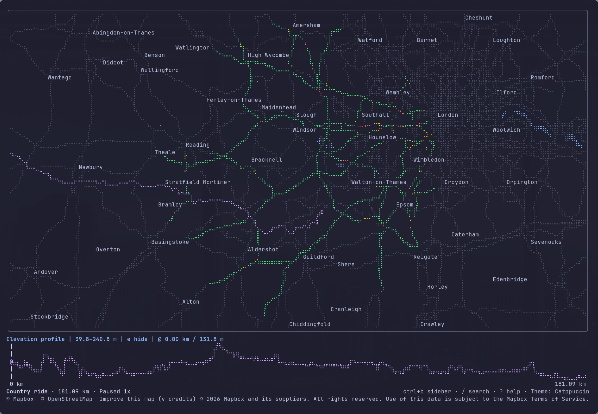
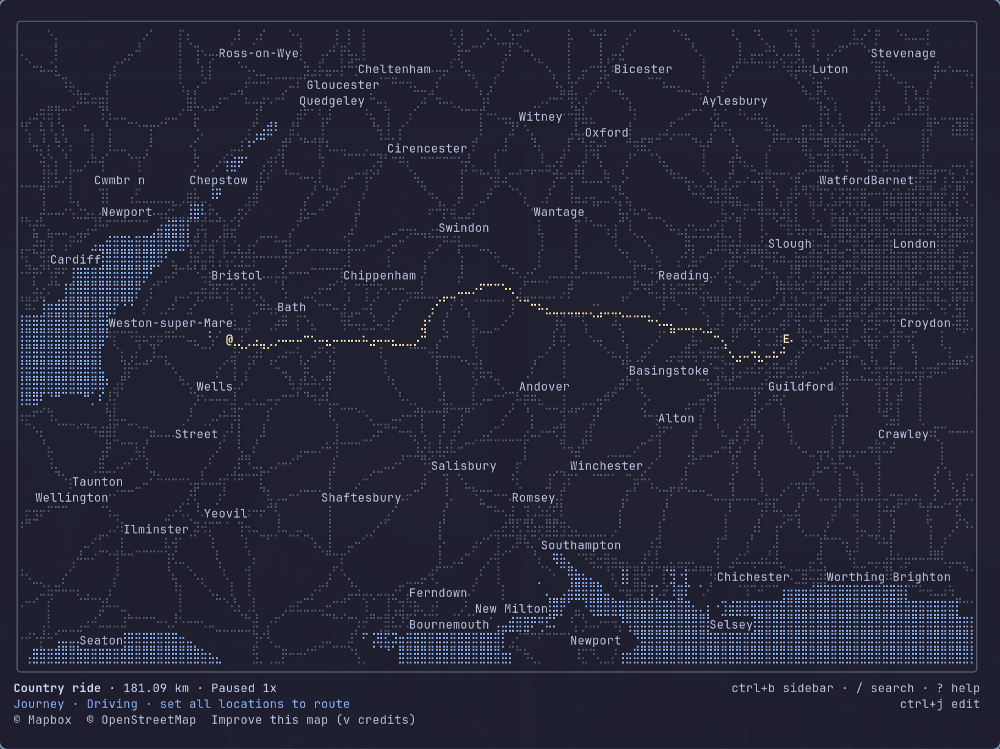
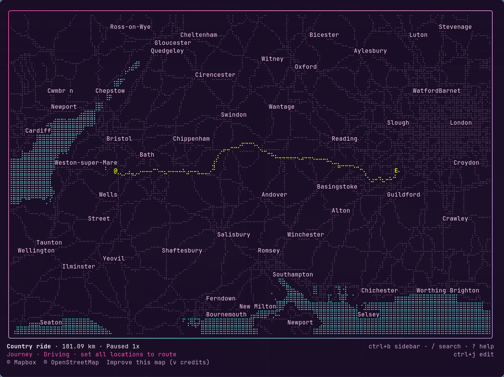
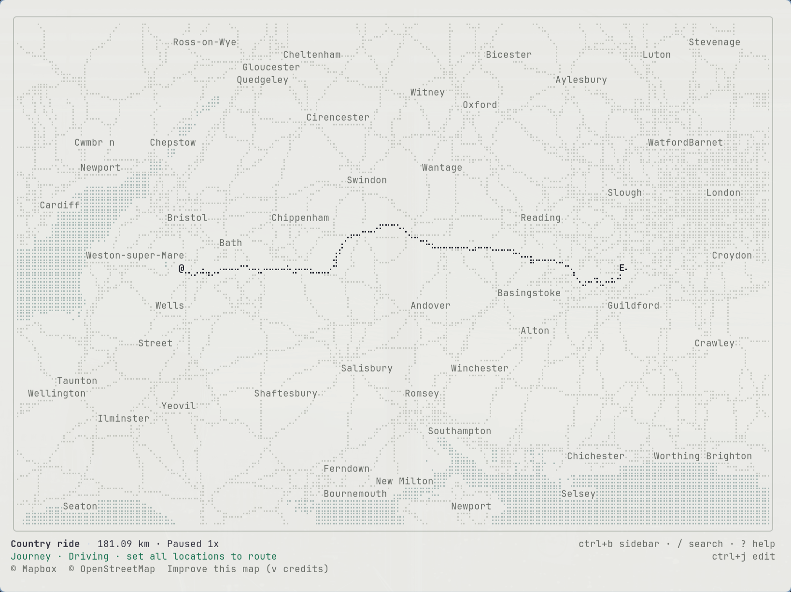
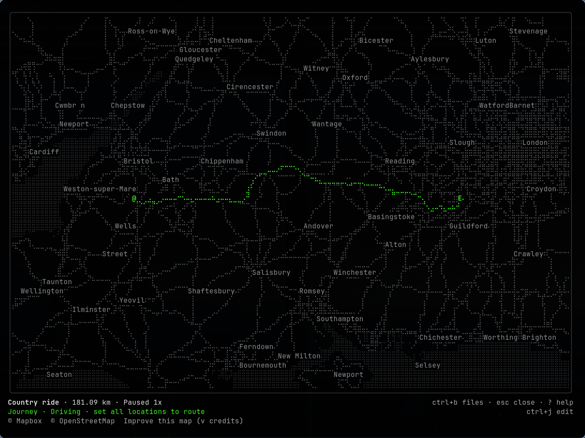

# Mapbox TUI

[](https://github.com/adamcbrewer/mapbox-tui/actions/workflows/ci.yml)
[](go.mod)
[](LICENSE)
[](#platforms)

A terminal map viewer and journey planner for GPX, FIT, TCX and KML files,
with a JSON CLI and local MCP server. Desgined to work with Mapbox for place, search and road routing, can be used offline.

[Getting started](#getting-started) · [MCP](#agent-workflow) ·
[Themes](#themes) · [Other terminal maps](#other-terminal-map-projects)



## Features

- **Activity inspection and playback.** Inspect recorded points and distances,
  view elevation profiles and replay tracks at different speeds. Playback uses
  recorded timing where available and labelled estimates otherwise.
- **Multiple files.** Load activities and planned routes together, select or hide
  individual items, and compare elevation profiles on a shared distance axis.
- **Journey planning.** Pick stops on the map and reorder waypoints. Manual plans
  work offline; Mapbox provides place search and walking, cycling and driving
  routes.
- **Shareable plans, locations and preferances.** Planned journey cli arguments can be copied and shared or bookmarked: reopen stops, travel mode and loaded files.
 Road routes are recalculated when reopened.
- **CLI and MCP.** Get JSON summaries, inspect points by distance and render
  ANSI-free text maps. The local MCP server keeps loaded files, selection and
  visibility between requests in its own session workspace.
- **Offline file support.** Import GPX, FIT, TCX and KML files, view elevation and
  replay recordings without an account. Connected features include Mapbox
  basemaps, search, road routing and an optional traffic overlay in the viewer.
- **Rendering and controls.** Braille and ASCII rendering, full keyboard and mouse
  navigation, map rotation, six built-in colour palettes and supports custom themes.

See [Usage](docs/USAGE.md) for controls, imports and playback details.

## Getting started

For prebuilt Linux x86-64 binaries, see [GitHub Releases](https://github.com/adamcbrewer/mapbox-tui/releases)
 and the [installation instructions](docs/INSTALL.md). Until the first release is
published, build from source below.

You'll need Go 1.27.1 or newer (see [go.mod](go.mod)). The Linux/macOS example
below uses Make; see [Platforms](#platforms) for a Windows build.

```sh
git clone https://github.com/adamcbrewer/mapbox-tui.git
cd mapbox-tui
make build && ./bin/mapbox-tui fixtures/country-ride.gpx --no-provider
```

That opens an activity without any Mapbox account setup. Swap in your own
file, or run `./bin/mapbox-tui` to explore without one. Press `?` for controls
and `q` to quit.

On Linux x86-64, `make install` puts the binary in `~/.local/bin`.
For basemaps, place search and road routing, [connect Mapbox](#mapbox).

## Agent workflow

MCP lets your agent inspect files, compare activities and render text maps.
Loaded files, selection and visibility carry over between requests.

This repository includes project-local configurations for Codex and OpenCode.
Build with `make build`, then start your agent in this checkout. See
[project MCP setup](docs/MCP.md#project-setup) for connection checks.

For other clients, add the binary as a local stdio server in your agent's MCP configuration:

```json
{
  "mcpServers": {
    "mapbox-tui": {
      "command": "/absolute/path/to/mapbox-tui/bin/mapbox-tui",
      "args": ["mcp"]
    }
  }
}
```

Use your actual repository path. If your client uses a different config format,
the command and argument are the same.

### Example prompts

Once connected, give your agent the absolute path to the repo and try:

```txt
Open fixtures/example.gpx with mapbox-tui. What's in it? Summarise the recorded activity separately from the planned route and waypoints.
```

```txt
Find the recorded point nearest 1 km, then show me an offline ASCII map of the activity at 60 by 20 cells.
```

```txt
Also load fixtures/waypoints.gpx. Hide Optional spur, keep the waypoints visible and render the workspace. Then show the spur again and redraw it.
```

Those examples use synthetic fixtures and work offline. For a recorded ride, try:

```txt
Open fixtures/country-ride.gpx. Summarise its distance and elevation, inspect the point nearest 90 km, then render an offline map of the whole ride.
```

MCP has its own workspace, separate from an open viewer. An agent with terminal
control can also use the viewer's journey planner, playback and live traffic.

See [MCP notes](docs/MCP.md) for workspace rendering and measurement details.
The [tool schemas](shared/tools.json) describe the available calls.

## Mapbox

You'll need a Mapbox account for online maps, place search and road routing.
Mapbox has a generous free tier with fair usage for personal use. See Mapbox's [signup guide](https://docs.mapbox.com/accounts/guides/signup/).

You can either sign up directlythrough the [Mapbox Console](https://console.mapbox.com/)
 or during a [Mapbox MCP server connection](https://docs.mapbox.com/accounts/guides/signup/#sign-up-with-mapbox-mcp-server-connection).

If you install the optional [official Mapbox CLI](https://github.com/mapbox/mapbox-cli#install) you can then sign in via:

```sh
./bin/mapbox-tui auth login
./bin/mapbox-tui auth status
```

The viewer, CLI and MCP reuse that login.

You can also supply a public token through `MAPBOX_ACCESS_TOKEN` for scripts. `--no-provider` disables the basemap, even having authed;
local file inspection and manual journey planning work without Mapbox.

Mapbox requests use your account and may incur charges. See the
[Mapbox notes](docs/MAPBOX.md) for configuration, usage, caching and
attribution.

## Terminal and CLI

```sh
./bin/mapbox-tui ride.gpx course.tcx
./bin/mapbox-tui summary fixtures/example.gpx
./bin/mapbox-tui inspect fixtures/example.gpx --point-index 3
./bin/mapbox-tui render fixtures/example.gpx --no-provider --json
```

Use `fixtures/country-ride.gpx` in the same CLI commands to try the longer ride.

In the viewer, Ctrl-O opens files, Ctrl-L manages loaded items, `/` searches
for places and Ctrl-J opens the journey planner. Ctrl-K opens the command
palette from any panel or dialog; Esc returns to the previous view.

`summary` and `inspect` return JSON. `render` gives you a text map; add `--json`
for scene metadata too. CLI and MCP maps are ANSI-free.

Use `./bin/mapbox-tui --help` or a subcommand's `--help` for options.
[Usage notes](docs/USAGE.md) cover controls, imports and playback.

## Other terminal map projects

There are some other great TUI projects out there which I drew inspiration from, but feature support and active development made me decide to take a fresh approach.
The main idea is Mapbox TUI would bring activity files, journey planning and CLI/MCP inspection together, using the features of Mapbox's ecosystem to drive a Google Maps sort of experience.

| Feature | Mapbox TUI | [MapSCII](https://github.com/rastapasta/mapscii#readme) | [ttymap](https://github.com/Kohei-Wada/ttymap#readme) | [TerminalMap](https://github.com/psmux/TerminalMap#readme) |
|---|---|---|---|---|
| Interactive terminal map | ✓ | ✓ | ✓ | ✓ |
| Braille rendering | ✓ | ✓ | ✓ | ✓ |
| Keyboard and mouse navigation | ✓ | ✓ | ✓ | ✓ |
| GPX, FIT, TCX and KML imports | ✓ | - | - | - |
| Activity elevation profiles | ✓ | - | - | - |
| Estimated elevation along planned routes | (proposed) | - | - | - |
| Recorded activity playback | ✓ | - | - | - |
| Visual comparison of imported routes | ✓ | - | - | - |
| Choose colours for individual imported activities | (proposed) | - | - | - |
| Journey planning with waypoints | ✓ | - | - | - |
| Walking, cycling and driving routes | Mapbox | - | - | - |
| Copy a command to recreate a journey | ✓ | - | - | - |
| Restore the last planned journey after restart | (proposed) | - | - | - |
| Headless map rendering | ANSI-free text via CLI/MCP | - | ANSI snapshots via CLI | ANSI frames via Rust SDK |
| JSON activity summaries and point inspection | ✓ | - | - | - |
| Local MCP server with a session workspace | ✓ | - | - | - |
| Session steering from a separate CLI process | (proposed) | - | - | - |
| Lua plugins and scripted scenes | - | - | ✓ | - |
| Embeddable map SDK | - | - | - | Rust SDK |
| Multiple independent map views | - | - | - | Via SDK |
| Custom vector tile servers | - | ✓ | - | ✓ |
| Offline activity file inspection | ✓ | - | - | - |
| Offline basemaps | - | Local vector tiles / MBTiles | MBTiles/PMTiles proposed | Bundled zoom 0 and 1 tiles |
| Persistent disk tile cache | (in-memory only) | ✓ | ✓ | ✓ |

This is just a comparison of documented workflows, checked **14 October 2026**, not a feature audit.
The linked project READMEs describe their current capabilities.

## Themes

Choose **Colour theme** from the Ctrl-K command palette to preview a palette,
or start with `--theme synthwave`. Click a screenshot to see it at full size.
See [Terminal themes](docs/THEMES.md) for all six built-in palettes and custom themes. New ones can easily be added.


<table>
  <tr>
    <td width="50%" align="center">
      <strong>Catppuccin</strong><br>
      <a href="docs/images/theme-catppuccin.png"></a>
    </td>
    <td width="50%" align="center">
      <strong>Synthwave</strong><br>
      <a href="docs/images/theme-synthwave.png"></a>
    </td>
  </tr>
  <tr>
    <td width="50%" align="center">
      <strong>Paper</strong><br>
      <a href="docs/images/theme-paper.png"></a>
    </td>
    <td width="50%" align="center">
      <strong>Noir</strong><br>
      <a href="docs/images/theme-noir.png"></a>
    </td>
  </tr>
</table>

## Platforms

The Go binary cross-compiles for Linux, macOS and Windows on x86-64 and ARM64.
CI runs the tests and terminal interaction checks on Linux. Native macOS and
Windows runtime behaviour has not yet been verified.

The viewer needs an interactive terminal with ANSI/VT support. The optional
[Mapbox CLI](https://github.com/mapbox/mapbox-cli#download-the-archive-yourself)
publishes binaries for all three platforms. Imported files work without it.

On Windows, build and run directly with Go from the repository root in PowerShell:

```powershell
go build -trimpath -o bin/mapbox-tui.exe ./go
.\bin\mapbox-tui.exe fixtures/example.gpx --no-provider
```

`make install` and `make package` currently require Linux x86-64. On macOS and
Windows, build from source and put the binary on your `PATH` yourself.

The development watcher, terminal interaction checks and shell-based auth test
helpers need a Unix-like environment. The viewer's **Copy journey to clipboard**
command uses POSIX shell quoting; adapt copied commands for PowerShell or Command
Prompt.

## Contributing

Contributions are welcome, especially docs improvements, bug reports and feature
requests. Try the setup or MCP examples and send a small PR for anything unclear,
outdated or missing.

[Open an issue](https://github.com/adamcbrewer/mapbox-tui/issues) to report a bug
or suggest a feature. Include steps to reproduce the bug or explain what you'd
like to do. See [Contributing](CONTRIBUTING.md) for more details.

## Development

You'll also need Python 3.11 or newer. Use `make dev` to rebuild on changes and
`make check` to run the offline checks. See [development notes](docs/DEVELOPMENT.md) for the
local workflow and terminal prerequisites.

## Further reading and other docs

- [Usage](docs/USAGE.md)
- [MCP](docs/MCP.md)
- [Mapbox](docs/MAPBOX.md)
- [Development](docs/DEVELOPMENT.md)
- [Release reference for maintainers](docs/RELEASING.md)
- [Architecture](docs/ARCHITECTURE.md)
- [Themes](docs/THEMES.md)
- [Go style](docs/GO_STYLE.md)
- [Contributing](CONTRIBUTING.md)

[MIT licence](LICENSE). [Third-party notices](THIRD_PARTY_NOTICES.txt).
