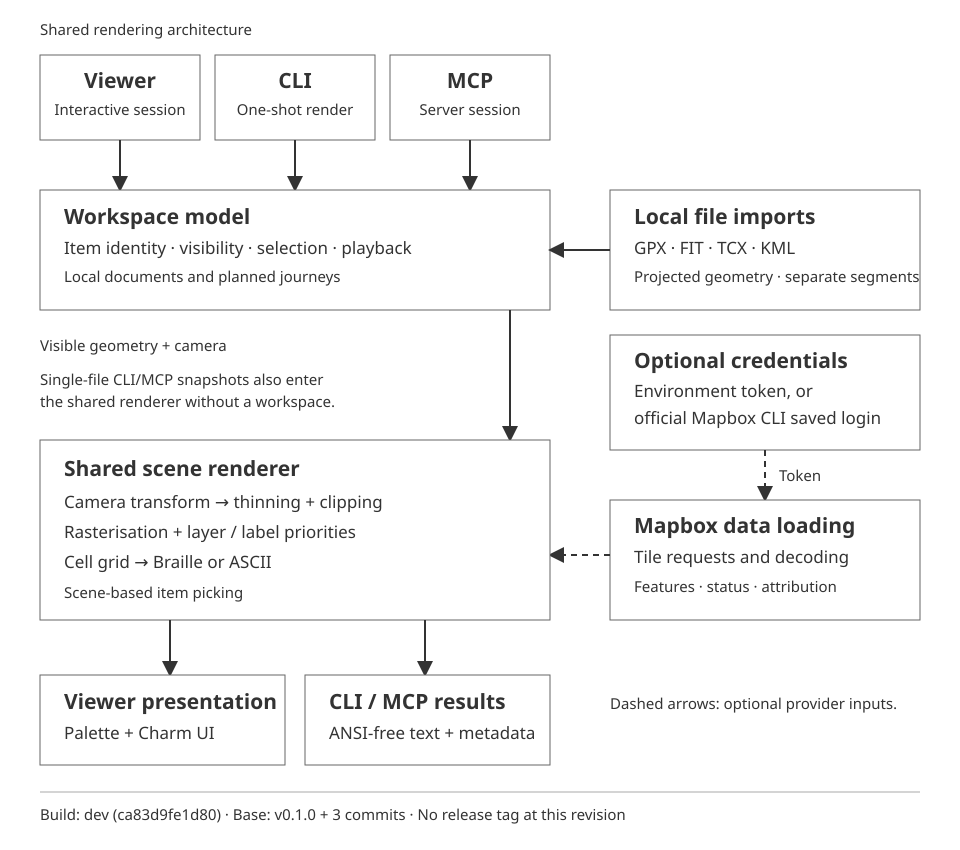

# Architecture

## Why Go and Charm

We chose Go mainly because we liked the Charmbracelet ecosystem. It gives us a
good starting point for the UI, with local geometry, providers, CLI and MCP in one
executable. The decision is about fit and development effort, not measured speed
against Rust.

- **Bubble Tea:** `Init` schedules work, `Update` handles input and results, and
  `View` returns the presentation. We apply workspace changes in the update loop.
- **Bubbles:** ready-made file picking, text input, help, scrolling, spinners and
  progress bars save us building those widgets ourselves.
- **Lip Gloss:** handles layout, borders and colours. Theme palettes are separate
  from geometry, so recolouring doesn't require another import or tile fetch.
- **Background work:** commands return file/provider results as messages. Go's
  goroutines, contexts and HTTP client make this straightforward; we still own
  cancellation and checks for stale results.
- **CLI/MCP:** reuse the same models and renderer without starting the UI. MCP
  uses the Go SDK's stdio transport.
- **Distribution:** one standalone `mapbox-tui` binary with embedded themes. Users
  don't need Go installed. The official Mapbox CLI is a separate, optional auth
  helper, not a map renderer or bundled runtime.

Versions live in [`go.mod`](../go.mod); build/package commands are in the
[`Makefile`](../Makefile).

## Shared model and rendering

We use the same workspace model and scene renderer for the viewer, CLI and MCP.
They live in one Go executable, so we don't have separate implementations of
selection, playback or map layering to maintain.

Viewer preferences live in `settings.json`, separate from `Workspace` and
favourites. We apply defaults, saved choices, then explicit CLI flags. User actions
save only the changed field. Theme previews and launch overrides don't save.
CLI renders and MCP keep their own defaults.

Elevation stores `auto`, `show` or `hide`; layout decides whether the visible data
can produce a chart. Theme fallback warnings stay separate from save errors.
Centre and zoom restore from `last_view` across startup imports and route results.
Navigation marks the view for one synchronous save after a clean exit.

Use `--reset-view` to delete the saved centre and zoom before the UI opens.

With `--safe-start`, we skip reading settings and saving the last view on exit.
Explicit launch flags still apply. Preference changes made in the UI use the
normal save path. We reject `--reset-view` alongside safe start because it would
change the settings the user asked to bypass.

Reads are capped at 64 KiB and reject unknown or invalid fields. Updates lock
`settings.json.lock`, reread, merge the changed field, then sync and rename a
same-directory temporary file. Busy or failed writes leave the previous file
intact. Replacement is verified on Unix; native Windows remains unverified.

We read legacy keys but write `mapbox_billing_accepted_version`, `camera_animation`
and `last_view` with `zoom`, `lat`, `long`. These replace `mapbox_billing_accepted`,
inverted `no_animation`, and `center_lat`/`center_lon`. Explicit new keys win,
including zero and false. Reading alone doesn't migrate the file.

The viewer owns its workspace. Multi-file CLI rendering creates a temporary
workspace; standalone MCP keeps one for the server process. Single-file CLI/MCP
snapshots use the shared renderer without a workspace.

CLI and MCP can also target a viewer's UUID session. Socket workers send typed
requests to its update loop; imports and routing return asynchronous results.
The loop serialises human and agent edits. The standalone MCP `Service` mutex
only protects that server's workspace.



### Shared live commands

Content insertion and selection are separate. Creating a journey leaves the
active recording alone. Human and agent playback commands use the same workspace
setters and revision tracking. Animation uses a shared viewer setter; only UI
changes save the preference.

Workspace journey operations own initial stop identities, chosen mode and undo
history, as well as replacement and waypoint insertion. Initializing a plan leaves
no empty draft to undo. Successful edits allocate stop IDs monotonically, including
after undo; rejected edits preserve the plan and its routing state. Viewer, startup
and live-control callers choose selection, camera and routing presentation separately.
Saved journeys use the same initialization, including incomplete drafts; restoration
then applies saved appearance, identity and automatic-routing choices.
The shared model enforces 2–5,000 stops per journey, including unset draft stops.
Provider routing separately accepts at most 25 stops; returned path coordinates
are not planning stops.

CLI and MCP validate arguments against the same embedded JSON schemas. Edits
advance the live revision; replacing or clearing the working copy changes its
generation. Saved checkpoints have separate revisions for storage conflicts.
The shared model doesn't yet report unsaved changes.

Cancel/clear commands have reserved capacity when ordinary work is full. Camera
transitions have IDs and report completion, cancellation or supersession through
operations. See [remote access](REMOTE_ACCESS.md) for limits and protocol details.

### Imports and workspace

We load GPX, FIT, TCX and KML into a common document model with named items and
geometry. During import, we project the coordinates and calculate bounds and
measurements. Moving the camera doesn't require another file read. Disconnected
segments stay separate, so we don't draw paths across gaps in a recording.
Each imported item (track, route, activity or KML placemark) accepts at most
100,000 coordinates across its segments and attached waypoints. Parsers reject
the whole import when an item exceeds the cap, without thinning or truncation.
Independent items have independent caps; this is not a workspace memory budget.

The workspace manages which items are loaded, visible and selected, along with
recorded playback. The camera determines how we view them. These rules don't
depend on the viewer's widgets or layout, so CLI and MCP can use them too.

Planned journeys use the same workspace and renderer. We keep the user's chosen
stops separate from the path returned by a routing provider. Plans don't have
recorded timestamps or elevation.

The app-wide favourites library has its own JSON store and location validation,
separate from `Workspace`. The viewer copies a favourite into a journey stop;
there are no live links back to the library. Mutations lock a separate file,
re-read the current entries and replace the JSON via a same-directory temporary
file and rename. Replacement is atomic on Unix; native Windows behaviour remains
unverified. Stable IDs and
expected values prevent stale rename/delete operations from changing another
entry or overwriting an edit. Location origins use the shared `placeSource` type
and constants in `go/place_source.go`. Favourites validate against that accepted
set on both reads and writes. Persisted source strings are format values: changing
one requires a file migration. Compatibility tests pin the existing spellings.

### Saved workspace checkpoints

`workspace_store.go` defines a versioned persistence model separate from runtime
`Workspace`, preferences and favourites. `workspace_saved.go` captures and restores
that model without viewer widgets, authentication or provider requests. The viewer
uses these operations for explicit Save/Open and `--workspace`; ordinary CLI renders
and standalone MCP still start with their own state and never restore a checkpoint
implicitly. Their shared scene renderer remains ANSI-free outside the viewer.

Version 1 accepts at most 4 MiB, 1,024 documents and 5,000 stops per journey.
Unknown fields, unsupported versions and invalid identities/state are rejected.
There are no older supported versions to migrate. Imports carry SHA-256 fingerprints
of their original bytes; parsing checks fingerprints before and after reading.
Saved document/item IDs are independent of runtime IDs. Document order is retained
for scene layering, including across partial loads and repairs. Original parser item keys
are applied only to byte-identical imports, including a deliberately retained subset
when items have been removed. Missing/changed imports retain complete references
and state separately from loaded geometry. Failed candidate loads leave the active
workspace intact. Repair also checks fingerprints before installing content.
Synchronous repair and asynchronous viewer repair both commit through
`Workspace.completeImportRepair`, which validates the current unresolved reference,
preserves selection, removes the resolved reference and restores document order.

The saved-workspace picker reads manifests into structured preview metadata.
Selection changes render that metadata without opening or parsing imported files.
Only an explicit Open builds a candidate; repeated Open actions are disabled while
it loads, and late results after cancellation are ignored. Picker details and
confirmation views render the same preview fields with separate layouts, without
inspecting or filtering presentation strings. Import availability remains unchecked
in the metadata preview and is reported after the candidate loads.

The picker filters names and sorts metadata in memory. Rows retain checkpoint
identity and the digest/revision observed during listing. Rename reuses the atomic
save path but changes only the stored name and revision/timestamps. Duplicate
checks and locks the source, preserves its saved contents, resolves relative import
paths against the source manifest and creates a new checkpoint ID. Delete checks
the same lock/digest/revision before removing only the checkpoint JSON. Its lock
file stays in place so other processes continue to lock the same inode. Deleting
the active checkpoint detaches it without clearing the working copy.

Shared workspace code compares a digest of savable state against an in-memory
baseline captured after opening or saving. Generated checkpoint metadata is
excluded; camera, selection, planner, imports and journeys are included. The
baseline uses restored runtime state, so missing imports and unavailable road
geometry don't themselves count as edits. Live command revisions and transient
provider state don't determine persistence dirtiness. The viewer checks this
comparison before Open or Start clean and offers Save/Discard/Cancel. A failed
save keeps the current workspace. No autosave or recovery files are created.

A save locks a separate lock file, rereads and checks both the revision and full file
digest, writes/syncs a same-directory temporary file, then renames it. Names never
select overwrite targets. Save As allocates a new checkpoint ID. Failed/conflicting
writes retain the working copy and original checkpoint. Native Windows replacement
semantics remain unverified, as with settings and favourites. Writes happen
synchronously in the viewer update loop, so there are no queued saves that can
outlive a workspace switch. Imports and candidate opens remain asynchronous.

Switching invalidates import/search/open requests and cancels old routes. Shared
workspace replacement keeps runtime document IDs monotonic, preventing old route
results from matching a new journey. Stops preserve source, provider ID and
attribution; undo history, requests, clients, credentials and provider geometry
aren't serialised. Restored journeys retain their chosen mode and show unresolved
straight-line previews until Mapbox is available for one automatic recalculation
per complete road journey. Failures require an explicit retry. The viewer restores
the planner journey independently of activity selection; background route results
preserve the restored camera. Preference last-view state
is separate from each checkpoint camera.

Start clean clears content and detaches the named checkpoint through the shared
workspace operation. We keep runtime IDs increasing so old results can't match
new items. The viewer clears planner, search and dialog state, invalidates imports
and candidate opens, and drops any pending startup journey. Clear journey uses
shared item removal to cancel that journey's route and keep the other items.
Both actions leave saves alone. Workspace saving is manual, and startup doesn't
restore the previous session.

### Mapbox data and offline use

We fetch and decode Mapbox vector tiles, then pass their features to the renderer
alongside local geometry. Each source includes its status and attribution. The
viewer refreshes sources independently in the background and rejects responses
that no longer apply. If a refresh fails, it can keep the previous data on screen
and mark it as stale. CLI/MCP load a snapshot for each render call.

For authentication, we use an environment token or a saved login through the
optional official Mapbox CLI. The CLI is installed separately and handles login
and credential storage. Mapbox TUI uses the token to make its own data requests.
The helper doesn't render anything.

Product access has one shared decision: offline preference, billing acceptance,
and the presence of a rendering credential determine whether requests are allowed.
Viewer startup and credential updates apply that decision when building clients;
search and connection messages use the same reason. CLI/MCP render entry points
apply it before making product requests. Endpoint permissions remain separate:
verifying Streets access does not prove Directions access.

Billing acceptance and the online preference are separate saved transitions.
Login enables online mode only after successful authentication; explicit Go online
enables it immediately after acceptance. The viewer owns dialog navigation and a
typed pending confirmation intent, consumed when the user responds or dismisses it.

Account usage has a separate lifecycle and comes from the saved-login account,
which can differ from the account behind an environment rendering token. The
viewer attempts usage once at startup, even offline, and after successful login.
Missing statistics access never disables otherwise permitted product requests.

Local files already contain the geometry we need to draw them, calculate
measurements and play back recordings. None of that needs a token or a network
connection. Without provider data, we draw the imports on an empty canvas.
We don't download basemaps for offline use. The tile cache is bounded and only
held in memory. Authentication, caching and attribution details are in
[Mapbox policies](MAPBOX.md).

### Rendering

We draw the map ourselves. Charm handles the surrounding UI and styling.
The rendering pipeline is:

1. Transform projected geometry through the camera into screen coordinates.
2. Thin route geometry to suit the screen resolution and clip drawing to the
   viewport, keeping disconnected segments separate.
3. Rasterise paths and shapes into terminal cells. Layer, marker and label
   priorities decide what appears where they overlap. Braille uses 2×4 dots per
   cell. ASCII uses symbols chosen by cell role from the same scene.
4. Format the grid for the front end. The viewer applies its palette and adds
   the UI. CLI/MCP map text is ANSI-free. CLI JSON output and MCP responses also
   include scene metadata, such as source status and attribution.

Picking uses the drawing rules to identify the item shown in a cell. Colours
are applied separately, so changing the theme doesn't require another import or
tile request.

There's only one foreground colour per terminal cell, and a limited number of
dots. We have to choose which overlapping features take priority. Some detail
gets lost, particularly where several routes or labels occupy the same cells.

## Tradeoffs

Go saves UI and integration work, but we still need to control allocations and
latency. Garbage collection (GC), per-frame grids, transformed slices, strings and
styling can affect memory and slow frames. Background imports/HTTP avoid waiting
in the UI loop; expensive rendering still delays input and playback. Average
render time alone doesn't tell us how responsive the app feels.

Go doesn't enforce exclusive pointer/slice ownership or prevent data races. We
rely on message ownership, service locks, cancellation and tests. Rust's ownership
checks catch more aliasing/lifetime mistakes at compile time, and it avoids a
tracing GC. It still needs our rules for stale responses and stable identity.

Terminal/platform behaviour needs testing with either stack. Network and terminal
delays are separate from renderer speed.

## Historical Go benchmarks

These are preserved results, **not fresh measurements**. The workloads time
different stages, so we can't add them together to estimate a full UI frame.

### Workspace scenes

Source: [`BenchmarkWorkspaceScene`](../go/scene_bench_test.go) and the original
[implementation-plan record at `9d14334`](https://github.com/adamcbrewer/mapbox-tui/blob/9d1433466c00feaa0b100ae5e715b19d660553ea/docs/IMPLEMENTATION_PLAN.md#progress),
the first retained record on main,
dated 8 October 2026. The measurement date wasn't recorded.

| Workload | Terminal cells | Recorded scene time |
|---|---|---:|
| One route with 100,000 points | 120×40 | Approximately 5.5 ms |
| Four routes with 100,000 points each | 120×40 | Approximately 21.8 ms |

The benchmark prepares synthetic London-area loops, fits the workspace, then pans
each iteration. Timing covers scene rendering and Braille plain-text generation
without provider features. It excludes preparation, parsing, network, ANSI/UI
painting, terminal output and input latency.

### Traffic geometry

Source: the original
[traffic-overlay record at `337e744`](https://github.com/adamcbrewer/mapbox-tui/blob/337e744fbd1936a805a2862224721b8dcc3d4c78/docs/VALIDATION.md#traffic-overlay).
Measured on **10 October 2026** using the same **7,494 London traffic features at
zoom 8**. Values are medians of three geometry-rendering runs.

| Terminal cells | 10-mile cap | 20-mile cap |
|---|---:|---:|
| 120×40 | 13.50 ms | 13.55 ms |
| 160×50 | 14.78 ms | 15.11 ms |

Both caps needed four tiles. Allocations matched at each viewport. The 10-mile
comparison used a temporary Go build overlay; production uses 20 miles. Timing
reused in-memory data and excluded network, tile decoding and ANSI/UI painting.
These results describe this London sample, not every location or zoom.

**Missing provenance for both records:** exact tested revision, toolchain/build
settings, CPU/OS, iteration counts and raw samples/allocation figures. Workspace
duration/repetitions are also unknown; hardware was just "this machine". The
linked revisions identify the notes, not confirmed tested builds. The traffic
sample and overlay weren't retained, so the commands below won't reproduce that
radius comparison.

### Run benchmarks and retain results

From the repository root, with Go meeting the minimum in `go.mod`:

```sh
make bench
go test ./go -run '^$' -bench BenchmarkWorkspaceScene -benchmem
```

These benchmarks use synthetic geometry without Mapbox credentials.
`make bench` builds with `go build -trimpath`, generates dense fixtures and runs
[`scripts/benchmark.py`](../scripts/benchmark.py):

- **Workloads:** `example.gpx`, 10,000-point and 100,000-point fixtures, each at
  120×40 and 160×50 cells.
- **Sampling:** three 200-frame runs; discard the first frame of each run; pool
  the remaining 597 samples for median/p95.
- **Other metrics:** median import/load time, median summary-process startup time,
  and median of the three per-process peak RSS values (`os.wait4`, Linux). RSS is
  resident memory for the whole process, not Go heap size.
- **Scope:** CLI [`bench`](../go/main.go) times camera pan, warm synthetic provider
  geometry rendering and plain-text generation. It excludes real tile fetching/
  decoding, event handling, ANSI/UI painting and display. Summary startup includes
  process launch, import, summary serialisation and exit, not first-map latency.
  The workspace benchmark separately covers multiple items without provider
  features. Neither harness measures end-to-end input latency.
- **Output:** ignored `reports/benchmark.json`, with platform, CPU, logical CPU
  count and method metadata. No saved report was available on 11 October 2026.

For new runs, save the report here or link a retained artefact. Include:

- Date, source/fixture revisions and any working-tree changes or overlays.
- Toolchain/dependencies, build flags/target and runtime settings (`GOMAXPROCS`,
  `GOGC`, `GOMEMLIMIT` where relevant).
- Hardware, OS, terminal/emulator and competing load.
- Point/item/feature/tile counts, viewport/camera, mode/panels and cache state.
- Timed stages, warm-up, duration, iterations/repetitions, raw samples,
  percentiles, allocations and memory metric/units.

## When we'd consider Rust + Ratatui

Rust + Ratatui could meet the same requirements. We'd consider a port if Go still
misses agreed performance budgets after profiling and practical optimisation.
Ratatui would cover the UI foundation; we'd still need equivalent map rendering,
imports, workspace rules and CLI/MCP behaviour.

### Proposed budgets

These are starting targets to agree on with reference hardware, not established
requirements or results. Here, p95/p99 mean 95%/99% of samples meet the limit.

| Metric | Proposed limit | Measure |
|---|---|---|
| Frame processing | p95 ≤33 ms, p99 ≤50 ms | Update, scene rebuild, UI styling/composition and terminal write during pan/playback |
| Local input-to-visible response | p95 ≤100 ms, p99 ≤150 ms | Input to the corresponding displayed frame, including queue, tick and emulator delay; network completion separately |
| Process memory | Peak RSS ≤256 MiB | Fixed workload, including imports, render buffers, UI and bounded provider caches |

Frame processing time isn't frame rate. The viewer requests its next 16 ms tick
after rebuilding, so a 33 ms rebuild can mean about 49 ms between updates. Measure
displayed-frame intervals separately. For memory, also check that live heap use
doesn't keep growing across load/remove/clear cycles; RSS needn't fall immediately.

Test both viewport sizes, one and four 100,000-point items, realistic basemap/
traffic, elevation, planner/dialogs, picking, pan/zoom/rotation, playback and
concurrent loads/refreshes. Check Braille/ASCII and cold/warm runs separately.
The historical timings can't tell us whether these interactive budgets pass.

### Profile, optimise, then compare

1. **Measure the failing workload.** Repeat UI/input-latency and peak-RSS runs.
   Separate rendering, GC, imports, network, decoding and terminal costs.
2. **Profile Go.** Use CPU/heap/allocation profiles and runtime traces. Check slow
   frames and allocation rate, not just averages.
3. **Try targeted fixes.** Reuse/preallocate buffers, reduce slice/string/styling
   allocations, avoid repeated geometry work, or add culling/spatial indexes and
   safe render caches where profiles justify them. Thinning, dirty rebuilds,
   elevation caching and bounded provider caches already exist. Measure runtime
   tuning's memory/latency tradeoff; preserve gaps, picking, freshness and plain
   ANSI-free output.
4. **Compare a matched Rust prototype if Go still falls short.** Match workload,
   geometry, projection/clipping/thinning, layers/UI, viewport, hardware and
   sampling. Use normal optimised Go builds and Rust release builds. A raw Rust
   geometry loop isn't comparable to a styled Go viewer.
5. **Port only if the improvement justifies the rewrite.** It should meet the
   agreed budgets and cover imports, providers and tool/UI integration. A network
   or terminal bottleneck alone doesn't justify a language change.

**Rust evidence:** as of 11 October 2026, no Rust source, Cargo project or saved
Rust/Ratatui results were found in the checkout, local reports or available Git
history. We don't have a baseline for claiming Rust is faster here. If results
turn up, record the prototype/revision and setup above. Compare directly only
where workload, pipeline, build optimisation, hardware and sampling match;
otherwise keep them as separate historical observations.
